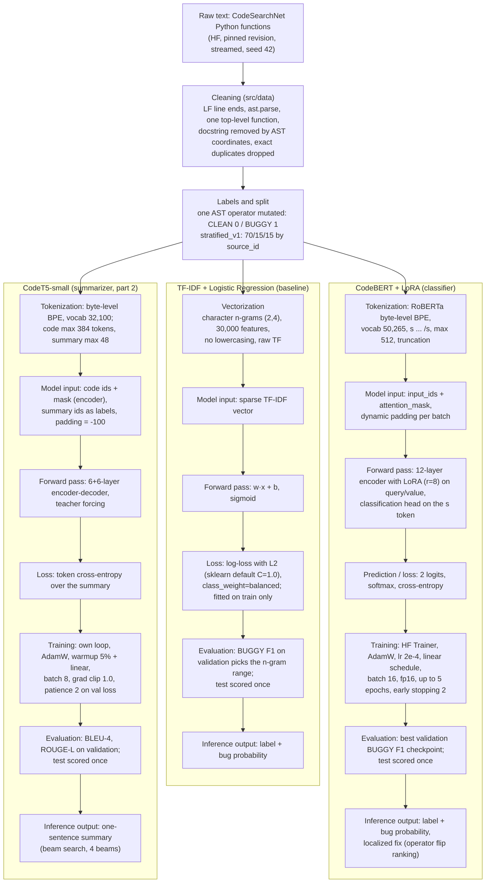

# Pipeline and input representation

How a Python function becomes a prediction, for the three models. Code is parsed and
tokenized, never executed. Every setting below is taken from the code named in brackets.

## End-to-end flow

## Input representation

| Model | Unit | Vocabulary | Length | What the model receives |
|---|---|---|---|---|
| TF-IDF + LR | character n-grams, 2–4 characters (chosen on validation from (2,4), (3,5), (3,6)) | 30,000 most frequent n-grams of train | whole function | a sparse vector of TF-IDF weights (`lowercase=False`, `sublinear_tf=False`), so operators such as `>=`, `!=` and ` and ` are features |
| CodeBERT | RoBERTa byte-level BPE subwords | 50,265 (`microsoft/codebert-base` config) | 512 tokens including `<s>` and `</s>`; longer functions are cut at the end, special tokens kept | `input_ids` and `attention_mask` (1 = real token, 0 = padding); batches are padded dynamically to their longest row (`DataCollatorWithPadding`, to a multiple of 8 under fp16) and grouped by length |
| CodeT5-small | byte-level BPE subwords | 32,100 (checkpoint config) | code up to 384 tokens, summary up to 48 tokens, both truncated | encoder: code ids and mask, raw code with no prompt; decoder: summary ids as labels, padding replaced by -100 so it is ignored by the loss |

Sources: `src/bug_detection/train_tfidf.py`, `train_comparison_tfidf.py`,
`models/tfidf_v2/metrics.json`; `src/bug_detection/train_lora.py`, `lora_common.py`
(`tokenize_once`), `models/codebert_lora/training_config.json`;
`src/summarization/train_codet5.py` (`make_batches`).

`scripts/demo_tokenize.py` prints these representations for one function.

## Outputs and loss functions

| Model | Output layer | Prediction | Training loss |
|---|---|---|---|
| TF-IDF + LR | one linear unit over the TF-IDF vector | sigmoid → bug probability; BUGGY if ≥ 0.5 | binary log-loss with L2 regularization (scikit-learn default `C=1.0`), `class_weight="balanced"`, `max_iter=2000` |
| CodeBERT + LoRA | `RobertaClassificationHead` on the `<s>` vector: dropout → dense 768→768 → tanh → dropout → `out_proj` 768→2 | softmax over 2 logits → bug probability; BUGGY if ≥ 0.5 (no tuned threshold is saved) | cross-entropy over the two classes (unweighted by default; `--class-weights` is optional and off) |
| CodeT5-small | encoder-decoder with a language-model head over the 32,100-token vocabulary | beam search: 4 beams, up to 48 new tokens | token-level cross-entropy over the summary with teacher forcing; padded label positions (-100) are ignored |

Generation settings for CodeT5: the test table in `docs/summarization-results.md` used 4 beams
and the default length penalty (1.0); so does the API on `main`
(`src/inference/models.py`). `src/summarization/summarize.py` uses 4 beams, length penalty
2.0, `max_new_tokens=48` and `early_stopping=True`; the API switches to these settings only
if the `feature/unify-summarizer` branch is merged.

LoRA in CodeBERT: the base weights are frozen; trainable are low-rank matrices on the
attention `query` and `value` layers (r=8, alpha 16, dropout 0.1) and the whole
classification head (`modules_to_save=["classifier"]`), 887,042 of 125,534,212 parameters
(0.71%).

## Inference path in the app

`POST /analyze` (`src/api/app.py`): the code is tokenized or vectorized as above, the model
returns the bug probability, and for a probability of at least 0.40 without reference code
`localize()` (`src/bug_detection/localize.py`) flips each operator back to every operator it
could have been mutated from, scores all candidates in one batch, and reports the candidate
that lowers the bug probability the most as the suspected line and fix, marked not verified.
With reference code, the exact AST difference is reported instead and marked verified.
