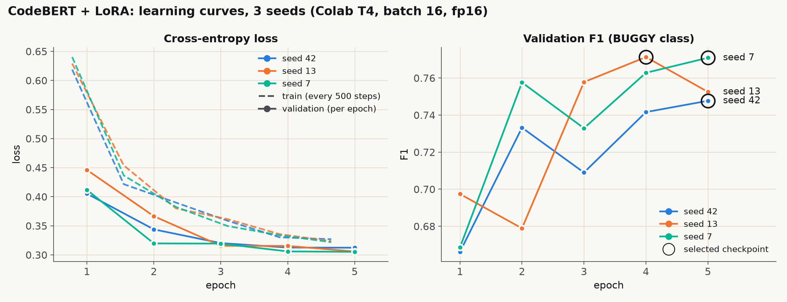
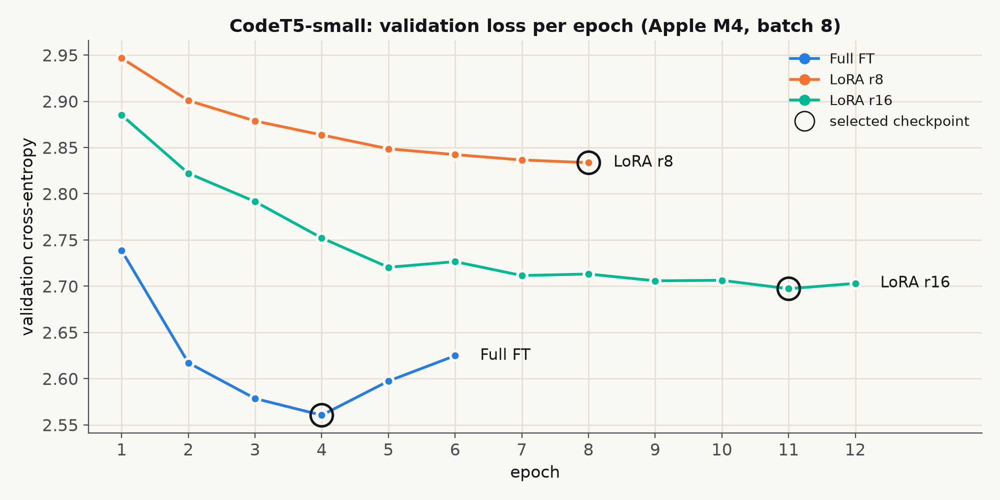

# Code Assistant: Bug Detection and Code Summarization for Python

Project report, NLP course 2026. Authors: Adul23 (part 1: bug detection, localization and
explanation), Saniya (part 2: function descriptions). Repository:
`github.com/Adul23/NLP-project-bug-summary`, code in `nlp-code-assistant/`.

Every number in this report comes from a file in the repository; the file is named next to
it. The data split is stated for every result. Things that were not measured are marked
**not measured**.

## 1. Problem statement and intended use

Given the source code of one Python function, the system answers three questions:

1. **Is there a bug?** A binary classifier labels the function BUGGY or CLEAN and returns a
   bug probability (TF-IDF + Logistic Regression baseline, CodeBERT + LoRA).
2. **Where is it, and what is the fix?** With the original code, the exact AST difference is
   reported (verified). Without it, the classifier ranks single-operator repairs and reports
   the suspected line and fix (marked not verified).
3. **What does the function do?** CodeT5-small writes a one-sentence, docstring-like summary.

"Bug" means one swapped operator (comparison, arithmetic or `and`/`or`), the kind of mistake
the training data contains. The system is a study and teaching tool, a second pair of eyes in
code review. It is not a verifier: it never executes code, cannot prove a function correct,
and on real bug fixes its detector is near chance (Section 10).

The product is a FastAPI backend (`src/api/app.py`) with a React frontend (`frontend/`):
`/analyze`, `/summarize`, `/feedback`, `/feedback/retrain`, `/health`.

## 2. Related work and choice of baselines

The project builds on public resources already referenced in the repository:

- **CodeSearchNet** ([Hugging Face](https://huggingface.co/datasets/code-search-net/code_search_net)):
  functions with docstrings from public GitHub repositories; our only data source.
- **CodeBERT** (`microsoft/codebert-base`, [repository](https://github.com/microsoft/CodeBERT)):
  a RoBERTa encoder pretrained on code and natural language, used as the transformer
  classifier.
- **CodeT5-small** (`Salesforce/codet5-small`, [model card](https://huggingface.co/Salesforce/codet5-small)):
  an encoder-decoder pretrained on code, used for summarization.
- **LoRA** via the [PEFT library](https://huggingface.co/docs/peft/en/package_reference/lora):
  trains low-rank updates of frozen weights instead of the full model.
- **BLEU** (Papineni et al., 2002) and ROUGE-L for summaries, implemented in
  `src/summarization/metrics.py`.
- **CTSSB-1M** ([TSSB-3M repository](https://github.com/cedricrupb/TSSB3M)): single-statement
  bug fixes mined from GitHub, used only to evaluate on real bugs.

Baselines, and why:

- **TF-IDF over character n-grams + Logistic Regression** for bug detection. It is the
  cheapest model that can see operators (`!=`, `>=`, ` and `) as features, trains in minutes
  on a CPU and gives a lower bound that a transformer must beat.
- **Random choice** among repair candidates for localization, the floor any ranking must beat.
- **AST template, TF-IDF retrieval and BM25 retrieval** for summarization: a rule-based
  description and two nearest-neighbour methods that copy the docstring of the most similar
  training function. They show how much of the score comes from copying, not generating.

## 3. Dataset

Full description: `docs/dataset-card.md`.

**Source.** CodeSearchNet, Python, upstream `train` partition, Parquet files pinned to
revision `7e3332b8032ff895377dba3e57f0152fcb32ff7d`, streamed with seed 42 and a shuffle
buffer of 1,000; reading stops after 10,000 accepted functions (`src/data/download_codesearchnet.py`).

**License.** Hugging Face lists the CodeSearchNet license as "other": every function comes
from a public repository under that repository's license, and the dataset has no per-example
license field. We use the data for course research only; the processed data is kept in the
course repository for reproducibility.

**Labels (part 1).** `label = 0` (CLEAN) is the original function; `label = 1` (BUGGY) is the
same function with exactly one AST operator replaced:

| Type | Replacements |
|---|---|
| comparison | `==→!=`, `!=→==`, `>→<`, `<→>`, `>=→>`, `<=→<` |
| arithmetic | `+→-`, `-→+`, `*→/`, `/→*` |
| boolean | `and→or`, `or→and` |

Only that operator's token is replaced in the source text; the result must parse and match
the mutated AST. A function gets at most one buggy version. The label is synthetic: it marks a
changed operator, not a proven failure, and CLEAN originals may contain real bugs.

**Split** (`data/processed/stratified_v1/manifest.json`; identical `split_manifest` in
`results/codebert_seeds/42/metrics.json`). 14,743 rows, 70/15/15 by `source_id`, so a
function and its mutant are always in the same split; groups are stratified by label
composition.

| Split | Rows | CLEAN | BUGGY | BUGGY share | comparison | arithmetic | boolean |
|---|---:|---:|---:|---:|---:|---:|---:|
| train | 10,320 | 7,000 | 3,320 | 32.2% | 1,354 | 1,284 | 682 |
| validation | 2,212 | 1,500 | 712 | 32.2% | 299 | 277 | 136 |
| test | 2,211 | 1,500 | 711 | 32.2% | 303 | 277 | 131 |

Pairwise `source_id` overlaps are 0; the manifest stores SHA-256 hashes of every split, and
each trainer checks them.

**Summarization data (part 2).** Input: the clean function without its docstring; target:
the cleaned first sentence of the original docstring. Only clean functions; noisy, too short,
too long, empty and non-English summaries are dropped, and rows whose summary appears verbatim
in the code are removed. Same split: train 6,524, validation 1,384, test 1,400; median
reference length 8 words (`docs/summarization-results.md`).

**Near duplicates** (`scripts/near_duplicates.py`, `results/near_duplicates.json`). For each
clean validation and test function, the maximum TF-IDF cosine similarity (code tokens,
1–3 grams) to any clean train function:

| Split | Functions | ≥ 0.8 | ≥ 0.9 | ≥ 0.95 | Median |
|---|---:|---:|---:|---:|---:|
| validation | 1,500 | 112 | 17 | 0 | 0.33 |
| test | 1,500 | 137 | 14 | 0 | 0.34 |

No exact copies remain, but near copies do: the closest pairs (0.945, 0.940) are sibling
methods of one class in one repository. The split separates functions, not repositories.

## 4. Preprocessing and tokenization

Full description and diagram: `docs/pipeline.md`; a runnable demo: `scripts/demo_tokenize.py`.

**Cleaning** (`src/data`): line endings normalized to LF; samples that `ast.parse()` rejects
are dropped; exactly one top-level `def`/`async def`; leading docstrings removed by AST
coordinates without reformatting; exact duplicates removed; IDs assigned after cleaning.
Code is parsed, never executed.

**Input representation.**

| Model | Unit, vocabulary | Length | Model input |
|---|---|---|---|
| TF-IDF + LR | character n-grams (2–4, chosen on validation), 30,000 features, no lowercasing | whole function | sparse TF-IDF vector |
| CodeBERT | RoBERTa byte-level BPE, 50,265 tokens, `<s> … </s>` | ≤ 512 tokens; longer functions are cut at the end | `input_ids` and `attention_mask` (1 = token, 0 = padding); batches padded dynamically and grouped by length |
| CodeT5-small | byte-level BPE, 32,100 tokens | code ≤ 384, summary ≤ 48 tokens | encoder: code ids and mask; decoder labels: summary ids, padding set to -100 |

In the test split, 404 of 2,211 functions are longer than 512 CodeBERT tokens and are
truncated (README, "By code length"), so a mutated operator near the end can be cut off.

## 5. Architecture and training methodology

| Model | Architecture | Output layer | Loss |
|---|---|---|---|
| TF-IDF + LR | linear model over TF-IDF features | one unit, sigmoid | binary log-loss with L2 (scikit-learn default `C=1.0`), `class_weight="balanced"` |
| CodeBERT + LoRA | 12-layer RoBERTa encoder (hidden 768, 125M parameters), frozen; LoRA r=8, alpha 16, dropout 0.1 on attention `query` and `value`; classification head trained fully | `RobertaClassificationHead` on the `<s>` vector: dropout → dense 768→768 → tanh → dropout → linear 768→2; softmax | cross-entropy over 2 classes |
| CodeT5-small | encoder-decoder, 6 + 6 layers, d_model 512, 60.5M parameters; full fine-tuning or LoRA | language-model head over the vocabulary; beam search with 4 beams at inference | token-level cross-entropy with teacher forcing |

CodeBERT + LoRA trains 887,042 of 125,534,212 parameters (0.71%); the adapter is 8.4 MB
(README, "Efficiency"). CodeT5 LoRA r8 (q, v) trains 294,912 parameters (0.49%, 1.19 MB),
r16 (q, k, v, o) 1,179,648 (1.91%, 4.74 MB), against 60,492,288 for full fine-tuning
(245.12 MB) (`docs/summarization-results.md`).

**Localization** (`src/bug_detection/localize.py`). For every operator in the function, each
operator that could have been mutated into it (the mutation tables read backwards) gives one
candidate repair. The original and all candidates are scored by the classifier in one batch;
the candidate that lowers the bug probability most is the suspected bug. The API shows it when
the bug probability is at least 0.40 and only if the drop is positive.

**Model selection.** All choices use validation: the TF-IDF n-gram range, the CodeBERT
checkpoint (best validation BUGGY F1), the CodeT5 checkpoint (best validation loss), the
CodeT5 LoRA rank. The test split is scored once, after selection.

## 6. Setup, hyperparameters and hardware

| | TF-IDF + LR | CodeBERT + LoRA | CodeT5-small |
|---|---|---|---|
| Code | `src/bug_detection/train_comparison_tfidf.py` | `src/bug_detection/train_lora.py`, `lora_common.py` | `src/summarization/train_codet5.py`, `train_codet5_lora.py` |
| Optimizer | lbfgs (scikit-learn default), `max_iter=2000` | AdamW (HF Trainer default), weight decay 0.01 | AdamW, weight decay 0.01 |
| Learning rate, schedule | — | 2e-4, linear, warmup 6% | full 1e-4, LoRA r8 2e-4, r16 5e-4; linear, warmup 5% |
| Batch, epochs | full batch | 16, up to 5 (645 steps per epoch) | 8, up to 8 (r16: up to 12) |
| Stopping, checkpoint | — | early stopping, patience 2; best validation BUGGY F1 | patience 2 on validation loss; best validation loss |
| Precision, other | — | fp16 | fp32; gradient clipping 1.0 |
| Seeds | 42 | 42, 13, 7 | 42 |
| Hardware | laptop CPU | Colab, Tesla T4 | Apple M4 (MPS) |
| Training time | not recorded | ~11 min per run (640–655 s) | full 37.7 min; LoRA r8 43.0, r16 58.6 min |

The first CodeBERT run used batch 1 with 8-step accumulation, fp32 and 3 epochs (66 minutes);
the current setup is about 6 times faster with test F1 within the seed spread
(`results/codebert_seeds.md`).

## 7. Metrics and results

### 7.1 Metrics

- **Bug detection:** F1 of the BUGGY class is the main metric. Only 32% of test functions are
  buggy, so a model that always answers CLEAN reaches 67.8% accuracy with BUGGY F1 = 0.
  Accuracy, precision, recall and macro F1 (unweighted mean of both classes) are reported too.
- **Localization:** top-1 and top-3 (is the exact fix first / among the first three), correct
  line first, and a random baseline.
- **Summarization** (`src/summarization/metrics.py`, no external libraries; lowercase
  `[a-z0-9]+` word tokens): **BLEU-4**, corpus-level geometric mean of 1–4-gram precisions with
  a brevity penalty, unsmoothed; **ROUGE-L**, F1 of the longest common subsequence per example,
  averaged over examples. Both measure word overlap with one reference; human evaluation and
  BERTScore were **not measured**.

### 7.2 Bug detection (test, 2,211 functions, threshold 0.5)

| Model | Precision | Recall | F1 (BUGGY) | Macro F1 | Accuracy |
|---|---:|---:|---:|---:|---:|
| TF-IDF + LR | 0.517 | 0.675 | 0.585 [0.554, 0.613] | 0.670 | 0.692 |
| CodeBERT + LoRA, mean ± std of 3 seeds | 0.766 ± 0.035 | 0.763 ± 0.038 | **0.764 ± 0.007** | 0.826 ± 0.006 | 0.848 ± 0.007 |

Sources: `results/tfidf_v2_metrics.json`, README "Measured: bug detection" (95% bootstrap
interval in brackets), `results/codebert_seeds/{42,13,7}/metrics.json`,
`results/codebert_seeds.md`. Per seed, test BUGGY F1 is 0.756 (seed 42), 0.767 (13) and
0.768 (7).

Confusion matrices (test; rows = actual, columns = predicted CLEAN / BUGGY):

| | TF-IDF + LR | CodeBERT, seed 42 |
|---|---|---|
| Actual CLEAN (1,500) | 1,051 / 449 | 1,340 / 160 |
| Actual BUGGY (711) | 231 / 480 | 182 / 529 |

CodeBERT seed 42 per class: CLEAN P 0.880 / R 0.893 / F1 0.887; BUGGY P 0.768 / R 0.744 /
F1 0.756; macro F1 0.821.

Further TF-IDF numbers (test): MCC 0.356, ROC-AUC 0.763, PR-AUC 0.525 (random 0.322), ECE 0.134;
with a threshold tuned on validation (0.455), test BUGGY F1 rises to 0.605. For the three
CodeBERT seeds, ROC-AUC, MCC, calibration and confidence intervals on the synthetic test split
were **not measured** (the per-row prediction protocol was not run for them).

Latency (README, `results/model_comparison.json`, `results/bench_inference.json`): on a warm
laptop CPU at batch 1, median 1.47 ms for TF-IDF and 244 ms for CodeBERT (first CodeBERT model,
same architecture), about 170 times slower. On a Tesla T4, CodeBERT takes 11.9 ms at batch 1
and 423 ms at batch 16 in fp32; fp16 autocast brings batch 16 to 113 ms with identical labels on
200 validation functions.

### 7.3 Localization (test, 711 mutants)

| | CodeBERT (seed 42) | TF-IDF | Random |
|---|---:|---:|---:|
| Exact fix ranked 1st | **78.2%** | 67.8% | 48.8% |
| Exact fix in top 3 | **92.3%** | 86.9% | 78.6% |
| Correct line ranked 1st | **86.2%** | 78.1% | — |

Paired McNemar test, top-1: CodeBERT alone is right on 112 mutants, TF-IDF alone on 38,
exact p = 1.2 × 10⁻⁹ (`results/localization/comparison.json`). When CodeBERT flags a function
as BUGGY (529 of 711), its first repair is the exact fix 86.2% of the time and on the right line
90.7%; on the 182 functions it misses, top-1 is 54.9% against 34.1% at random
(`docs/bug-localization-results.md`).

### 7.4 Summarization (test, 1,400 examples, scored once)

| Method | BLEU-4 | ROUGE-L | Latency (median) | Size |
|---|---:|---:|---:|---:|
| AST template | 0.0079 | 0.2237 | – | – |
| TF-IDF retrieval | 0.1840 | 0.3283 | – | – |
| BM25 retrieval | 0.1770 | 0.3251 | – | – |
| CodeT5-small, full fine-tuning | 0.1398 | **0.3862** | 118.5 ms | 245.12 MB |
| CodeT5-small + LoRA r16 | 0.1066 | 0.3620 | 133.6 ms | 4.74 MB |

Source: `docs/summarization-results.md`, `results_summarization/comparison_test.md`
(4 beams, default length penalty; latency on Apple M4, batch 1). Full fine-tuning has the best
ROUGE-L; retrieval has the best BLEU-4 because it copies real docstrings. Predictions are short:
6.48 words (full) and 6.25 (LoRA) against 9.26 in the references, which lowers BLEU through the
brevity penalty (0.6512 and 0.6175). The ranking of methods on test matches validation.

## 8. Learning curves

Values: `results/learning_curves.json`; figures: `python scripts/plot_learning_curves.py`.

**CodeBERT + LoRA** (3 seeds, Colab training logs). Validation loss falls from 0.41–0.45 after
epoch 1 to about 0.31 and flattens; train loss (mean of the last 500 steps) ends near 0.32. There
is no sign of overfitting. Validation loss is below train loss early on because the train value
averages steps with dropout during the epoch, while validation is measured at its end without
dropout. Validation F1 jumps between epochs at threshold 0.5 while the loss is smooth. For 2 of
3 seeds the best epoch is the last (5), so the model may be slightly undertrained (not tested).

**CodeT5-small.** Full fine-tuning overfits after epoch 4 (validation loss 2.5604 at epoch 4,
2.6248 at epoch 6); early stopping ends it at epoch 6. LoRA r8 is still improving at epoch 8,
where the linear schedule reaches zero. LoRA r16 flattens after epoch 5; its best epoch is 11
(2.6972). Train loss per epoch is not in the repository (r16 only: 3.843 → 2.486).

## 9. Error analysis

**Bug detection (CodeBERT seed 42, test).** 182 of 711 buggy functions are missed and 160 of
1,500 clean functions are flagged. TF-IDF flags 449 clean functions. For TF-IDF, and/or swaps are
the hardest (recall 0.550, against 0.706 for comparison and 0.700 for arithmetic), and accuracy
falls with length (0.830 in the shortest quartile, 0.547 in the longest). Per-row CodeBERT
predictions on clean functions are not saved, so false alarms are known only as a count.

Three test mutants (`results/localization/codebert_rows.csv` joined with the test split):

- **Found and fixed:** `prepare_relationship`, line 5, `route = '/' - model_name.lower()`.
  p(BUGGY) = 0.99; the first repair, `-` → `+`, is the exact fix (1st of 4 candidates).
- **Missed:** `datacol_to_array`, line 27, `if arr.size == datacol.nelems:` (original `!=`),
  in a 41-line function. p(BUGGY) = 0.15, so CLEAN; ranking alone would put the exact fix first
  of 6, but the API localizes only from 0.40.
- **Wrong fix:** `pfLon`, line 11, `return angle.norm(asc + sun + moon)` (original
  `asc + sun - moon`), in the `else` branch of an `if` whose other branch returns
  `asc + moon - sun`. p(BUGGY) = 0.88; the first repair is on line 9, the other branch, and the
  exact fix is 2nd of 4.

How to investigate a case: `scripts/demo_tokenize.py` shows the tokens, truncation, probability
and ranked repairs for one function.

**Localization.** CodeBERT is ahead for every mutation type (top-1: comparison 76.9%,
arithmetic 77.6%, boolean 82.4%). The two models fail on different functions: CodeBERT misses
mostly long functions (7.2 candidates on average against 4.0 for those it flags), TF-IDF mostly
short ones (2.2 candidates) (`docs/bug-localization-results.md`).

**Summarization** (`docs/summarization-results.md`, validation review files). For LoRA r8 on
validation: too short and generic (471 of 1,384), good 147, medium 371, bad 150; full
fine-tuning: too short 403, good 230, medium 364, bad 152. Typical errors: the summary
follows the function name instead of the behavior (`_getSmallestDifference` → "Get the smallest
difference between two values." where the function returns the closest value); text copied from
comments and identifiers; repeated generic phrases ("run the command."); and reasonable
predictions scored low because of noisy references.

## 10. Evaluation on real bugs

`scripts/collect_real_bugs.py` takes CTSSB-1M (CC BY 4.0) records with the pattern
`CHANGE_BINARY_OPERATOR`, downloads both file versions and keeps functions where exactly one of
our operators changed: 500 pairs from 488 repositories (1,000 functions); 344 pairs are
changes the training mutations produce ("in tables"), 156 are not. Nothing was retrained
(`docs/real-bugs.md`, `results/real_bugs/`).

| | CodeBERT | TF-IDF | Random |
|---|---:|---:|---:|
| Buggy vs fixed, ROC AUC (1,000 functions) | 0.530 [0.493, 0.566] | 0.503 [0.465, 0.538] | 0.5 |
| Exact fix 1st (344 in-table pairs) | **44.2%** | 37.8% | 28.5% |
| Exact fix in top 3 (344 in-table pairs) | **78.2%** | 69.5% | 61.3% |

The detector does not separate buggy from fixed real code: it learned what our mutations look
like, not what real bugs look like. Localization keeps some signal on real fixes of the trained
kind, and CodeBERT beats TF-IDF (McNemar on top-1: 60 vs 38 pairs, p = 0.033). 31% of the real
fixes (156 of 500) cannot be proposed at all, because nothing in the mutation tables produces
`<=` or `>=`.

## 11. Limitations and ethics

- **Synthetic labels.** BUGGY means one swapped operator; a swap may not change behaviour, and
  CLEAN originals may contain bugs. On real bug fixes the detector is near chance (Section 10).
- **Split by function, not by repository.** Near copies remain across splits (Section 3), so
  test scores may be optimistic for code from repositories seen in training.
- **Pretraining overlap.** CodeBERT and CodeT5 were pretrained on CodeSearchNet and may have
  seen the test functions.
- **Truncation.** CodeBERT reads 512 tokens; 404 of 2,211 test functions are longer.
- **Different hardware.** TF-IDF and the first CodeBERT model were timed on a laptop CPU,
  CodeBERT also on a T4, CodeT5 on an Apple M4; latencies are not directly comparable.
- **One seed** for TF-IDF and CodeT5; three seeds for CodeBERT.
- **Code is never executed.** All processing parses and tokenizes code; no user code is run.
- **Licenses.** CodeSearchNet functions keep their repositories' licenses; the dataset has no
  per-example license information. The data is used for course research only.
- **Generated text can be wrong.** CodeT5 summaries can invent details or follow the function
  name instead of the behavior (Section 9); the localized fix is marked not verified.
- **User data.** The API stores feedback and uncertain predictions, including the submitted
  code, in `data/feedback/` for retraining; a deployment would need consent and retention rules.

## 12. Conclusion and next steps

CodeBERT + LoRA, training 0.71% of its parameters in about 11 minutes on a T4, reaches test BUGGY
F1 0.764 ± 0.007 over three seeds against 0.585 for the TF-IDF baseline, and ranks the exact fix
first for 78.2% of synthetic test mutants. Fully fine-tuned CodeT5-small gives the best
summaries by ROUGE-L (0.386 on test), and a LoRA adapter 52 times smaller loses 0.024 ROUGE-L.
On real GitHub fixes the detector is near chance, while localization keeps part of its signal.

Next steps (not done):

- train or fine-tune on real bug fixes and add mutation types for `<=`, `>=` and non-operator bugs;
- split by repository and re-measure;
- run the per-row protocol (ROC-AUC, MCC, calibration) for the CodeBERT seeds;
- evaluate summaries with people or a semantic metric;
- switch the API to fp16 inference, measured 3.8 times faster at batch 16 on a T4.

## Appendix: where things are

| What | File |
|---|---|
| Data download, cleaning, mutations | `src/data/` |
| Split and manifest | `src/bug_detection/split_dataset.py`, `data/processed/stratified_v1/manifest.json` |
| TF-IDF training | `src/bug_detection/train_tfidf.py`, `train_comparison_tfidf.py` |
| CodeBERT training config | `src/bug_detection/train_lora.py`, `lora_common.py` |
| CodeT5 training | `src/summarization/train_codet5.py`, `train_codet5_lora.py` |
| Metrics | `src/evaluation/bug_metrics.py`, `src/summarization/metrics.py` |
| Localization | `src/bug_detection/localize.py`, `src/evaluation/localization_eval.py` |
| Results | `results/`, `results_summarization/`, `docs/*.md` |
| Tokenization demo | `scripts/demo_tokenize.py` |
